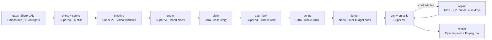

# Narrate: audio description for videos, written and checked by NVIDIA Nemotron

**Narrate writes audio description for blind and low-vision viewers. It describes only where nobody is speaking, and when a video leaves no room it pauses the picture, describes what has just happened, and resumes.** Every word of description comes from NVIDIA Nemotron models on **Nebius Token Factory**, and every claim is checked against still frames by a second model before it is spoken. Built for the Nebius × NVIDIA hackathon (Apps & Agents track), Oct 27–30 2026. License: Apache-2.0.

> **Status (2026-10-29):** English narration. 278 offline tests pass (Windows 10, Python 3.12.10, ffmpeg 9.0.2). Real runs on Nebius Token Factory have been done for all five sample clips in both modes (see [Results](#results-nebius-token-factory-2026-10-29)). Known weaknesses are listed in [Limitations](#limitations-and-published-failure-cases): please read them before relying on any output.

Two modes, same pipeline:

| Mode | Command flag | What it does | Output |
|---|---|---|---|
| **In-gap** (default) | `--ad-mode ingap` | Speaks only inside speech-free gaps, with the original audio ducked under the voice | `narrated_en.mp4`, `ad_en.vtt`, `transcript_en.txt` |
| **Extended** | `--ad-mode extended` | Freezes the video at safe boundaries and speaks a fuller description (WCAG 2.x SC 1.2.7), then resumes | `extended_en.mp4`, `extended_en.m4a`, `ad_extended_en.vtt`, `pause_plan.json` |

Every run also writes `trace.json` / `trace.md` (every model call with model, tokens, cost and latency) and `report.json` (coverage, overlaps with speech, cost, issues).

> Audio description supports WCAG 2.x SC 1.2.5 (prerecorded) and 1.2.7 (extended). Narrate is an assistive drafting tool, not a compliance certification. **Human review is still required.**


---

## Quickstart (offline, no key)

Requirements:

- Python 3.12 or newer (tested on 3.12.10 on Windows and 3.13 on Linux).
- **A current `ffmpeg`/`ffprobe`** (tested with 9.0.2). Old builds are not enough: ffmpeg 4.3.1 deadlocked on the extended-mode render and lacks two filter options. Narrate feature-detects the options, but upgrade ffmpeg if you can.
- `espeak-ng` (fallback voice).
- Optional but recommended: the Piper English voice for a natural sound (below).

```bash
python -m venv .venv
# Linux/macOS: .venv/bin/pip ...        Windows: .venv\Scripts\pip ...
.venv/bin/pip install -r requirements.txt
.venv/bin/pip install silero-vad --no-deps          # MIT Silero VAD ONNX model, no torch
.venv/bin/python -m pytest -q                       # fully offline, 278 tests
.venv/bin/python scripts/serve_cached_demo.py       # demo player on http://127.0.0.1:7860 (cached real runs, zero cost)
.venv/bin/python -m narrate agent samples/sample_kitchen.mp4 --out runs/demo --provider mock
```

On Windows, use `.venv\Scripts\python` and install the tools with `winget install eSpeak-NG.eSpeak-NG` and `winget install Gyan.FFmpeg`. Put both on `PATH` (ffmpeg before any older copy). `pip install pytest-xdist` and `pytest -n 4` cut the suite to about a minute.

`--provider mock` is scripted and offline. It exercises the whole pipeline (stages, verification, fallback, TTS, mixing), but its descriptions are synthetic and its costs are $0. **Never read mock output as a quality or cost number.**

### Natural voice (Piper, English)

```bash
pip install piper-tts
bash scripts/download_voices.sh        # downloads en_US-ljspeech-medium (public domain) into voices/
```

With the voice present, `tts.backend: auto` in `config.yaml` uses Piper; otherwise it uses espeak-ng. Voices run locally. Narrate never sends audio or text to a speech service. The Hindi Piper voice is not downloaded (see [Limitations](#limitations-and-published-failure-cases)).

## Real mode

```bash
# Nebius Token Factory
export NEBIUS_API_KEY=...            # read from env only, never from files or the browser
.venv/bin/python scripts/smoke_provider.py        # readiness check, ~$0.01, prints READY / NOT READY
.venv/bin/python -m narrate agent my_clip.mp4 --out runs/real --provider nebius --budget-usd 0.50
.venv/bin/python -m narrate agent my_clip.mp4 --out runs/ext  --provider nebius --ad-mode extended --budget-usd 0.30
.venv/bin/python -m narrate agent my_clip.mp4 --out runs/real --provider nebius --context "One-line title of the video"
```

`--context` is optional, unverified text (a title or one line) that the writer may use; it is never treated as evidence.

| Provider | Key env | Base URL (override: `NARRATE_BASE_URL_NEBIUS` / `_NVIDIA_DEV`) | Use |
|---|---|---|---|
| `nebius` (default) | `NEBIUS_API_KEY` | `https://api.tokenfactory.nebius.com/v1/` | final runs and demo numbers |
| `nvidia-dev` | `NVIDIA_DEV_API_KEY` | `https://integrate.api.nvidia.com/v1` | development only; reports are marked `dev_only: true` |
| `mock` | – | – | offline tests and demo |

- If the provider's key is missing, the run exits with code 2 and a clear message. It never falls back to mock silently.
- **`scripts/smoke_provider.py`** runs the real code paths with tiny inputs and checks that every configured model ID is served, that Nano returns JSON, that Ultra returns a tool call, and that Super VL reads on-screen text from a 4 s MP4 sent as `video_url` and from frames. **On Nebius it passed all 6 checks on 2026-10-29** (spend cap $0.05).
- Model IDs live in `config.yaml` (`providers.nebius.models`). Override one per role with an env var such as `NARRATE_MODEL_ORCHESTRATE=nvidia/nemotron-3-super-120b-a12b` (roles: `PERCEIVE`, `FIT`, `FIT_ALT`, `EDIT`, `ORCHESTRATE`, `ORCHESTRATE_ALT`). `scripts/list_models.py --provider nebius` lists what your key can see.
- Every run has a hard spend cap (SpendGuard). Raw model responses are saved truncated, with no headers, and keys are never logged.

## How it works (the director pipeline)

`python -m narrate agent ...` runs the **director** pipeline by default (`--mode director`; design notes in `DESIGN_v2.md`). Cheap models look at the whole clip first, one strong model writes the whole track in one call, and a different modality checks every claim.



1. **Gaps.** Silero VAD finds speech-free windows. Gaps under 1.5 s are skipped and long gaps are split into slots at scene cuts. Each slot gets a word budget measured from the real TTS voice, and cue timestamps come only from detected gaps, so models cannot move narration over speech.
2. **Look.** ffmpeg finds shot cuts; Super VL describes 6 stills for the scene context, then watches the whole clip in ~12 s video windows and logs events.
3. **Zoom (new).** Where an event is vague handling of an object ("passes a small object"), Super VL first locates the hand-and-object activity, then looks again at frames cropped to it, asking concrete questions (cut, sliced, torn, opened, handed over, eaten). Results become ordinary events and are verified like everything else. See the limitation below: it does not always see small actions.
4. **Bible.** Ultra turns the events into a scene bible: place, cast with stable descriptors, objects, story and beats.
5. **Cast look (new).** The bible is written from text, which rarely says who is a woman or a man. Super VL looks at one frame per camera shot and decides each cast member's apparent gender **only when a face, hair or body makes it clearly visible**, citing what it saw. Otherwise the narration keeps "they" or the descriptor. Nothing in the code assigns a gender.
6. **Script, tighten, verify, repair.** Ultra writes the whole English track in one call (at most 6 Ultra calls per run). Nano shortens cues that are only over budget. Super VL then checks every cue against 2 still frames from inside its own gap (extended mode: 5 stills per cue). Contradicted cues go back to Ultra for at most 2 repair rounds and are dropped if they still fail.
7. **Render.** The voice is synthesised, measured, fitted into the gap, and mixed over the ducked original audio.

Deterministic guards run throughout: word budgets, banned phrasing ("we see", camera directions, a literal `TITLE` label, "Screen…"), duplicate-cue refusal, spend/step/time budgets, retries with backoff on HTTP 5xx/429/timeouts, and a fallback finisher that commits only verified cues.

The older tool-calling agent loop (Ultra as orchestrator with tools) is still available as `--mode agent`; the legacy one-shot pipeline as `--mode pipeline`. Their history and published failures are in `issues-found/` and `blog-assets/BLOG_NOTES.md`.

### Extended mode

```bash
python -m narrate agent samples/cooking_roti_0028-0148.mp4 --out runs/ext/roti --provider nebius --ad-mode extended
```

- Pause points come from ffmpeg scene cuts, Silero VAD speech ends, −30 dB micro-silences (for continuous speech), a frame-difference detector and key events; there is always a pause on the final frame.
- The timing contract is strict: pause only after an event ends, and describe only events that have already happened.
- Each cue is written by Ultra, linted deterministically, then verified by Super VL on stills; failing cues are repaired or rescued, and the run reports any pause it could not fill.
- The renderer builds each segment separately and muxes once, so cost grows linearly with the number of pauses and audio is encoded a single time. (An earlier single filter graph that trimmed one input 2n+1 times did not scale and could stall ffmpeg.)
- Extended mode is English-only.

**Archived Round 8c runs** (kept under `runs/ext/final/`, checked by `scripts/check_doc_numbers.py`):

| Clip | Source | Output | Pauses |
|---|---|---|---|
| roti | 119.9 s | 229.1 s | 8 |
| lecture | 30.0 s | 64.5 s | 3 |

Both archived reports record zero overlaps with Narrate's detected speech. The fresh runs below replace them as the current results.

## Nemotron, model by model

| Role | Token Factory model | Why this model |
|---|---|---|
| Writer, bible, repair | `nvidia/Nemotron-3-Ultra-550b-a55b` | Strongest writing; it sees structured events and a scene bible, never raw video. At most 6 calls per run. |
| Perceive and verify | `nvidia/Nemotron-3.5-Super-VL` | Accepts **video input** (base64 MP4 `video_url`) for the timeline, and still images (full frames and crops) for the scene context, zoom, cast look and verification. |
| Tighten | `nvidia/NVIDIA-Nemotron-3-Nano-30B-A3B` | Cheap and fast; follows hard word budgets. |
| Orchestrator (`--mode agent`) | Ultra, or `nvidia/nemotron-3-super-120b-a12b` via `--orchestrator super` | Tool-calling loop in the older agent mode. |
| Hindi (optional) | `nvidia/Nemotron-3-Ultra-550b-a55b` | Native Hindi cues if you ask for `--lang en,hi`. Not part of the current demo. |

All models run with reasoning disabled through `chat_template_kwargs.enable_thinking=false`; with thinking on, reasoning consumed the whole `max_tokens` budget and returned empty content.

## Where Token Factory helps

- **One OpenAI-compatible API for the whole Nemotron family.** Ultra, Super VL and Nano are just different `model` strings on one client and key. Per-role model choice is what makes the economics work: the expensive model writes once, and the cheap models look and tighten.
- **Price spread inside one provider.** Per 1M input/output tokens: Nano $0.06/$0.24, Super VL $0.30/$0.90, Ultra $1/$3. Narrate prices every call from reported usage and enforces per-run, per-session and per-day caps.
- **Verified on Nebius (2026-10-29):** model catalog, JSON mode, tool calling, base64 `video_url` input and image input all worked, and the committed five-clip runs completed. During development some attempts hit `APITimeoutError` while uploading video windows; those runs were repeated, and the pipeline records a lost window as an issue in `report.json` instead of failing. **Not measured:** cached-input pricing and regional data planes (`base_url` per model is supported in config).

## Results (Nebius Token Factory, 2026-10-29)

All figures are real runs on Nebius Token Factory with the English Piper voice, taken from the committed `samples/cached_runs/*/report.json` and `extended_report.json`. Costs are as reported by the run. "Gap coverage" is the share of narratable gap time that received a cue; it is a temporal proxy, not a measure of how useful the description is.

| Clip | In-gap cues | Gap coverage | Overlaps | In-gap cost | Extended pauses | Extended length | Overlaps | Extended cost |
|---|---|---|---|---|---|---|---|---|
| Kitchen (synthetic), 30 s | 4 | 68% | 0 | $0.011 | 3 | 30.0 → 68.5 s | 0 | $0.013 |
| Cooking (roti), 120 s | 11 | 53% | 0 | $0.041 | 5 | 119.9 → 193.2 s | 0 | $0.062 |
| Tears of Steel, 100 s | 8 | 67% | 0 | $0.034 | 2 | 100.0 → 128.2 s | 0 | $0.061 |
| NASA harvest, 110 s | 7 | 31% | 0 | $0.050 | 8 | 110.0 → 198.6 s | 0 | $0.060 |
| Continuous speech, 30 s | 0 (refused by design) | – | 0 | $0 | 3 | 30.0 → 64.7 s | 0 | $0.013 |

- Total cost of these runs: about $0.35 for all five clips in both modes, i.e. roughly $0.01–0.10 per clip.
- Overlaps are counted against Narrate's own speech detection. For Tears of Steel an earlier run was also checked against the film's subtitles: 41.7 s of the 75 s dialogue-free time was narrated and 0.39 s overlapped subtitled dialogue from one VAD boundary. "0 detected overlaps" does not prove 0 real overlaps.
- In extended mode three clips report that the coverage guarantee was not met (a pause could not be filled with a cue that passed verification): roti, Tears of Steel and NASA. The reports list which pauses are missing. For Tears of Steel only 2 pauses survived, so use its in-gap version.
- A review copy of the videos, captions and reports with a per-clip issue list is in `FINAL_OUTPUT/` (see `FINAL_OUTPUT/REVIEW.md`). It was produced just before the cast-look and zoom stages and is a little older than `samples/cached_runs/` for roti and NASA.

**Earlier rounds (NVIDIA dev endpoint, Oct 28).** Seven real-run rounds each found a failure, published in `issues-found/` and `blog-assets/BLOG_NOTES.md`. For the record, the Oct 28 dev-endpoint runs of the older agent code cost $0.05–0.17 per clip (86–96% of it Ultra orchestration) and took 3–6 minutes per 100 s clip; the current director pipeline costs less per clip on Nebius (table above), because Ultra writes once instead of orchestrating. The two runs are on different endpoints, so this is an indication, not a controlled comparison.

## Limitations and published failure cases

We publish failures. Older ones have evidence, a root cause and a status in [`issues-found/`](issues-found/README.md), and raw traces are in [`blog-assets/`](blog-assets/).

- **Small actions can be missed.** On the NASA clip, a crew member slices a chili with a knife at about 78–87 s. Super VL read the same moment as people passing "a small object" or "a bottle", and the narration never mentions the cutting. The zoom stage was added to catch this and fixed a real cropping bug along the way, but on this 640×360 clip the model still does not report the cutting. A one-line `--context` title is only a hint and is not detection.
- **Apparent gender comes from a vision model and can be wrong.** Narrate uses she/he only when Super VL cites a clearly visible face, hair or body, but the answer is not stable. On NASA the person in the green shirt, who is a woman in the frames, was called a man in some runs and a woman in others. If this matters for your video, review the narration. We do not guess gender from clothing, role or activity.
- **The vision model hallucinates**, especially motion and on-screen text. On Tears of Steel, Super VL claimed on-screen texts the frame verifier contradicted (`blog-assets/11_*`). The verifier is fallible too: it sometimes accepts claims its own evidence disagrees with, and it rejected text the perception model had just read. Verification reduces errors; it does not prove correctness. Earlier runs showed an invented detail ("step two") that a verifier marked supported.
- **Extended-mode coverage is incomplete on some clips** (see Results): a pause whose cue fails verification twice is dropped, leaving a stretch with no description.
- **Continuous speech means no safe gaps.** The lecture clip gets 0 in-gap cues by design; extended mode describes it in 3 freezes.
- **The speech detector is not ASR.** Silero misses some robotic or quiet speech, and music can mask gaps.
- **Coverage is a temporal proxy.** Events during dialogue are listed as `events_in_speech_regions` and cannot be narrated in-gap.
- **Voices.** The shipped caches use Piper `en_US-ljspeech` (public domain) when its model is present, otherwise espeak-ng, which sounds robotic. Narrate does not call any speech service. Hindi is not part of this release: the Hindi pipeline still exists (`--lang en,hi`, using espeak for the voice), but the only Piper Hindi voice (`hi_IN-priyamvada`) is CC BY-NC-SA (non-commercial), so it is neither bundled nor downloaded, and Hindi has had no native-speaker review. `scripts/render_magnific_*.py` are optional offline tools for re-voicing with pre-made ElevenLabs/Magnific clips; the current caches do not use them, and such audio is subject to Magnific's terms, not this repo's license.
- **Licensing.** The Tears of Steel soundtrack is listed under CC BY-ND 3.0. Narrate only ducks it, but check before redistributing narrated outputs.
- **Platform.** Developed on Linux and re-tested on Windows 10 with ffmpeg 9.0.2 (the results above were produced on Windows). Very old ffmpeg builds (4.3.1) fail on extended-mode rendering.
- Only clips of 2 minutes or less.

## Web UI

- **`python scripts/serve_cached_demo.py`**: a small, zero-cost player for the cached runs. Pick a clip and switch between **Extended** and **In-gap**; it shows the original and described videos, the WebVTT cues and the report/trace downloads. It never runs inference or opens a share link.
- **`python -m app.app`** serves the fuller Gradio UI on 127.0.0.1:7860 (not shared by default): a Samples tab with the in-gap results, an **Eyes closed** toggle (audio only), the trace with model chips and corrections, the results card and downloads; and a Run tab to upload a clip of up to 120 s and 50 MB and watch the trace stream live. Live-run limits: $0.25 per run, 24 orchestrator turns, 300 s (`NARRATE_UI_RUN_CAP`, `NARRATE_UI_MAX_TURNS`, `NARRATE_UI_TIMEOUT_S`); $0.25 per session and $3.00 per IST day (`runs/ui_spend.json`). `nebius` appears only if `NEBIUS_API_KEY` is set on the server; keys never come from the browser.
- Rebuild the caches (both modes, English): `python scripts/build_cached_runs.py --provider nebius [--samples NAME ...]` (about $0.10 per clip). Screenshots: `python scripts/screenshot_ui.py`.

## Samples and licenses

| File | Source | License |
|---|---|---|
| `sample_kitchen.mp4`, `failure_continuous_speech.mp4` | generated by `scripts/make_sample.py` | Apache-2.0 (ours) |
| `tears_of_steel_0015-0155.mp4` + `.en.srt` | *Tears of Steel*, © Blender Foundation, mango.blender.org | CC BY 3.0 (soundtrack caveat above) |
| `nasa_chile_harvest_0000-0150.mp4` | NASA Image and Video Library, `Plant_Habitat-04_Harvest` | NASA media guidelines; no endorsement implied |
| `cooking_roti_0028-0148.mp4` | Maple Kitchen, *How To Make Soft Layered Roti - Paratha*, [YouTube FX3KAGdnKQk](https://www.youtube.com/watch?v=FX3KAGdnKQk), 0:28–2:28 | CC BY 3.0 (YouTube "Creative Commons Attribution license (reuse allowed)"); trimmed and re-encoded, audio description added; no endorsement implied |

Details: [`samples/SOURCES.md`](samples/SOURCES.md). Silero VAD (MIT): [`narrate/assets/`](narrate/assets/README.md). espeak-ng and Piper (GPL-3.0) are run as external CLIs and are not vendored.

## Repository map

```text
narrate/         director + extended director, provider client + SpendGuard, perception, media/ffmpeg, TTS
narrate/agent/   older tool-calling agent loop, VAD
app/             Gradio UI          scripts/   samples, smoke tests, cache builder, demo player, scoring
tests/           offline pytest      issues-found/   published failures and fixes
samples/         clips + cached_runs/ (both modes)   FINAL_OUTPUT/   review copy of videos, captions, reports
blog-assets/     dated evidence + BLOG_NOTES.md      DEMO_SCRIPT.md, DEVPOST.md   demo and submission text
```

Development notes: the coding was delegated to Codex and Claude CLIs under human direction (see `_agent_logs/`). Every real-run number above was measured from the committed reports, not estimated.

## License

Apache-2.0. See [LICENSE](LICENSE). Copyright 2026 Nandigam Hari Krishna.
