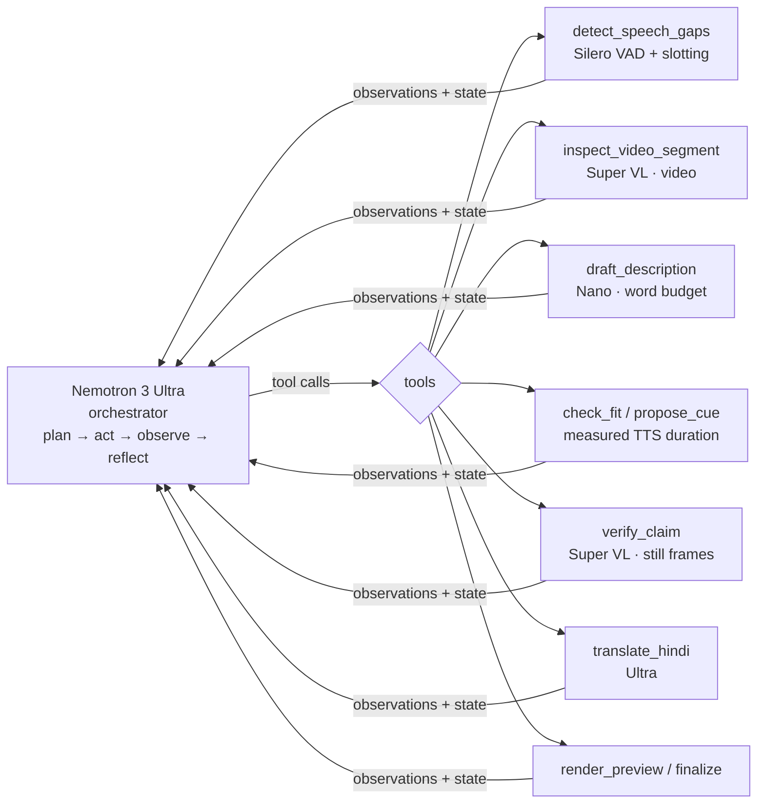

# Narrate: an agent that writes audio description

**Upload a video of up to 2 minutes. Narrate returns an audio-description track for blind and low-vision viewers, in English and Hindi.** It writes descriptions only into the moments when nobody is speaking, checks its own claims before it speaks them, and outputs:

- WebVTT description tracks (`ad_en.vtt`, `ad_hi.vtt`) and plain-text transcripts;
- narrated MP4s with the original audio ducked under each description;
- `trace.json` / `trace.md`, the full agent trace (every tool call, model, token count, cost and correction);
- `report.json`, the results card (coverage, overlaps, verifications, cost per minute, latency).

Narrate is a **tool-calling agent built on NVIDIA Nemotron**, designed to run on **Nebius Token Factory**. It was built for the Nebius × NVIDIA hackathon (Apps & Agents track), Oct 27–30 2026. License: Apache-2.0.

> Audio description supports WCAG 2.x SC 1.2.5 (Audio Description, prerecorded). Narrate is an assistive drafting tool, not a compliance certification. Human review is still required.


---

## Quickstart (offline, no key, about 2 min)

You need Python 3.13 (tested), `ffmpeg`/`ffprobe`, and `espeak-ng` (with `en` and `hi` voices).

```bash
git clone <this repo> narrate && cd narrate
python3 -m venv .venv
.venv/bin/pip install -r requirements.txt
.venv/bin/pip install silero-vad --no-deps          # MIT Silero VAD ONNX model, no torch
.venv/bin/python -m pytest -q                       # fully offline
.venv/bin/python -m app.app                         # web UI → http://127.0.0.1:7860 (cached real runs, zero cost)
.venv/bin/python -m narrate agent samples/sample_kitchen.mp4 --out runs/demo --provider mock
```

`--provider mock` is scripted and offline. It exercises the whole agent loop (tools, corrections, verification, fallback, TTS, mixing), but its descriptions are synthetic and its costs are $0. **Never read mock output as a quality or cost number.**

## Real mode

```bash
# Final runs: Nebius Token Factory
export NEBIUS_API_KEY=...            # read from env only, never from files or the browser
.venv/bin/python scripts/smoke_provider.py        # one-command readiness check, ~$0.01, prints READY / NOT READY
.venv/bin/python -m narrate agent my_clip.mp4 --out runs/real --provider nebius --strict --budget-usd 0.50
.venv/bin/python -m narrate agent my_clip.mp4 --out runs/real --provider nebius --orchestrator super   # about 3x cheaper orchestration

# Development only: NVIDIA build endpoint (free tier, 40 rpm)
export NVIDIA_DEV_API_KEY=...
.venv/bin/python -m narrate agent my_clip.mp4 --out runs/dev --provider nvidia-dev --strict
```

| Provider | Key env | Base URL (override: `NARRATE_BASE_URL_NEBIUS` / `_NVIDIA_DEV`) | Use |
|---|---|---|---|
| `nebius` (default) | `NEBIUS_API_KEY` | `https://api.tokenfactory.nebius.com/v1/` | final runs and demo numbers |
| `nvidia-dev` | `NVIDIA_DEV_API_KEY` | `https://integrate.api.nvidia.com/v1` | development testing only; reports are marked `dev_only: true` |
| `mock` | – | – | offline tests and demo |

- If the provider's key is missing, the run exits with code 2 and a clear message. It never falls back to mock silently.
- Each model entry in `config.yaml` can set its own `base_url`, for example a regional data-plane URL such as `https://api.tokenfactory.us-central1.nebius.com/v1/`.
- **`scripts/smoke_provider.py [--provider nebius|nvidia-dev]`** runs the real code paths with tiny inputs. It checks:
  - every configured model ID is served (if not, it suggests similar served IDs);
  - Nano drafting returns JSON;
  - Ultra returns a tool call;
  - Super VL reads on-screen text from a 4 s MP4 sent as `video_url` and from frames.

  Spend cap $0.05; exit 0 means ready. On nvidia-dev it passed all 6 checks for $0.0035. Without a key it exits 2 and makes no calls.
- **Model IDs** live in `config.yaml` (`providers.nebius.models`). You can override one per role without editing files, for example `NARRATE_MODEL_ORCHESTRATE=nvidia/nemotron-3-super-120b-a12b` (roles: `PERCEIVE`, `FIT`, `FIT_ALT`, `EDIT`, `ORCHESTRATE`, `ORCHESTRATE_ALT`).
- `scripts/list_models.py --provider nebius` lists the Nemotron IDs your key can see.
- Every run has a hard spend cap (SpendGuard). Real-mode raw responses are saved, truncated, with no headers. Keys are never logged.

## How the agent works



1. **Plan.** Ultra receives the video facts and a step, spend and time budget. It calls `detect_speech_gaps`: Silero VAD finds speech-free windows, gaps under 1.5 s are skipped, and long gaps are split into 6–12 s slots at scene cuts. The same tool runs one **scene-context** pass: Super VL looks at 6 evenly spaced frames and returns the setting, who is visible (by appearance only), the ingredients, the tools, the activity and whether subtitles are burned in. Inspection, drafting and translation all receive this brief, so the first cue says where we are and who is there, and later cues can name the rolling pin or the wooden bowl instead of "an object".
2. **Act.** It inspects each slot with **Super VL**, which watches the actual video segment. What it sees goes onto a persistent **evidence board** that survives history compaction, and re-inspecting a covered slot is refused. An event belongs to a slot only if its midpoint falls in the slot, or it overlaps the slot by at least max(1 s, half the event), or it covers half the slot. Events that only touch the edge of a slot no longer leak into its line. Then it drafts all slots in one batched **Nano** call. The drafter sees the two previous committed lines and may answer `SKIP` for an action slot with nothing new; that slot then stays silent. It never skips the establishing slot, and it is never asked to draft a slot that has no evidence of its own. Every gap has a single `max_words` limit, shared by the drafter and the checker. A draft over the limit is re-asked once and then cut deterministically, keeping any on-screen text first.
3. **Observe.** `propose_cue` synthesises the line with the real TTS voice, measures how long it takes to speak, and checks four things: it fits the gap, it does not overlap speech, it is no longer than 8 s, and it is not a duplicate. Failures come back with reasons. On a second failure the tool redrafts the line itself, so the 550B model never counts words.
4. **Reflect and self-verify.** `finalize` refuses to finish while any risky cue is unverified. Risky means it quotes on-screen text, numbers or names, came from low-confidence perception, or was written by the orchestrator itself. Those claims go to `verify_claim`, which uses a different modality (still frames rather than video). A contradicted claim is un-committed and redrafted. The events it was based on are marked refuted and leave the evidence board, so the same hallucinated title cannot be drafted again.
5. **Hindi.** Ultra translates the cues, then the Hindi lines are re-checked for timing. Hindi runs longer, so fit is measured on the Hindi TTS.
6. **Finish.** The narration is mixed with the original audio ducked, and the tracks, transcripts, report and trace are written.

Safety rails:

- step, spend and wall-clock budgets;
- retries with backoff on HTTP 5xx, 429 and timeouts;
- a deterministic **fallback finisher**: on any stop it commits the best fitting candidates, drafts missing slots in one batched call, verifies every risky cue (it may go past the orchestrator's verification cap, but not past the spend budget), **drops any risky cue it could not verify**, ignores drafts built on refuted evidence, and finalizes;
- banned phrasing is enforced in code, not only in the prompt: "we see", camera directions ("Camera moves…", "the camera"), a literal `TITLE` label (write `Title: "…"`), cues that start with "Screen", and `SKIP`. Such a line fails `check_fit`, and the drafter is re-asked. A cue that is at least 50% the same as the previous cue is refused;
- cue timestamps come only from detected gaps, so models cannot move narration over speech;
- tool errors are explicit: `invalid arguments: …` or `unknown gap_id N; valid gap ids: […]`. In real runs, opaque errors (`ValidationError`, `StopIteration`) made Ultra retry blindly for 13–21 calls.

The trace is the product's centrepiece. Every step records the role, a short public `note` (required on every tool call; it is not chain-of-thought), arguments, results, model, tokens, cost, latency and correction links. The web UI streams it live.

API: `narrate.agent.run_agent(path, out_dir, provider, langs, max_steps, budget_usd, on_step=callback)`. The old fixed pipeline is kept as a baseline: `python -m narrate pipeline ...`.

## Nemotron, model by model

| Role | Token Factory model | Dev-endpoint model | Why this model |
|---|---|---|---|
| Orchestrator | `nvidia/Nemotron-3-Ultra-550b-a55b` (or `nvidia/nemotron-3-super-120b-a12b` via `--orchestrator super`) | `nvidia/nemotron-3-ultra-550b-a55b` | Reliable multi-step tool calling with parallel calls. It decides what to inspect, what to rewrite and what to verify. |
| Perceive and verify | `nvidia/Nemotron-3.5-Super-VL` | `nvidia/nemotron-3.5-super-vl-120b-a12b` | Accepts **video input** (base64 MP4 `video_url`, confirmed) for perception, and still images for independent verification. |
| Draft | `nvidia/NVIDIA-Nemotron-3-Nano-30B-A3B` | `nvidia/nemotron-3.5-lightning-30b-a3b` (Nano is not enabled on the dev key) | Cheap and fast enough to call once per slot or batch, and it follows hard word budgets. |
| Hindi | `nvidia/Nemotron-3-Ultra-550b-a55b` | same | The best multilingual quality of the set; it is one call per run. |

All four run with reasoning disabled through `chat_template_kwargs.enable_thinking=false`. With thinking on, reasoning consumed the whole `max_tokens` budget and returned empty content. `/no_think` alone did not disable it.

**Measured usage by model stage**, from the shipped Nebius Token Factory caches. Vision calls include scene context, perception and verification; edit calls are Hindi translation. Costs are the sums of the per-call `cost_usd` values in each report.

| Clip | Ultra orchestrator | Super VL | Nano draft | Ultra edit | Total |
|---|---|---|---|---|---|
| Cooking (roti), 120 s | 41 calls, 305.2k in / 3.4k out, $0.3153 | 19 calls, $0.0114 | 17 calls, $0.0027 | 1 call, $0.0026 | **$0.3320** |
| NASA harvest, 110 s | 22 calls, 154.0k / 2.5k, $0.1614 | 19 calls, $0.0122 | 11 calls, $0.0015 | 1 call, $0.0032 | **$0.1783** |
| Tears of Steel, 100 s | 16 calls, 111.0k / 2.2k, $0.1177 | 17 calls, $0.0104 | 3 calls, $0.0008 | 2 calls, $0.0051 | **$0.1339** |
| Kitchen (synthetic), 30 s | 17 calls, 89.9k / 1.2k, $0.0934 | 7 calls, $0.0030 | 3 calls, $0.0002 | 3 calls, $0.0023 | **$0.0989** |
| Continuous speech, 30 s | 2 calls, 6.6k / 70 out, $0.0068 | – | – | – | **$0.0068** |

Orchestration is 88–95% of the cost in the four caches that produced cues. Its input grows each turn. Every shipped report records `cached_tokens: 0` for every call; no cache discount was observed. `--orchestrator super` is available as a lower-list-price alternative, but the shipped caches use Ultra.

## Where Token Factory helps

- **One OpenAI-compatible API for the whole Nemotron family.** The orchestrator, vision, drafting and translation models are just different `model` strings on the same client and key. Per-role model choice is what makes the economics work: the expensive model only plans, and the cheap model writes.
- **Price spread inside one provider.** Per 1M input/output tokens: Nano $0.06/$0.24, Super VL $0.30/$0.90, Ultra $1/$3. Narrate prices every call from reported usage and enforces per-run, per-session and per-day caps.
- **Cached-input pricing** is configured for the repeated prompt prefix, but every call in the shipped reports has `cached_tokens: 0`; the measured totals therefore received no cache discount.
- **Model catalog and regional endpoints.** `/v1/models` and the per-model `base_url` in config cover regional data planes.

## Results card

All figures below come from the real **Nebius Token Factory** runs in `samples/cached_runs/*/report.json`. Overlaps are measured against Narrate's speech detector.

| Clip | Turns | Cues / narratable gaps | Gap coverage EN / HI | Detected overlaps | Verified / contradicted / unverified | Cost | Cost per min | Model latency |
|---|---|---|---|---|---|---|---|---|
| Cooking (roti), 120 s | 41 | 10 / 12 | 52% / 55% | 0 | 3 / 2 / 0 | $0.332 | $0.17 | 162 s |
| NASA harvest, 110 s | 22 | 10 / 10 | 53% / 67% | 0 | 4 / 1 / 1 | $0.178 | $0.10 | 115 s |
| Tears of Steel, 100 s | 16 | 8 / 8 | 50% / 58% | 0 | 4 / 1 / 0 | $0.134 | $0.08 | 83 s |
| Kitchen (synthetic), 30 s | 17 | 3 / 4 | 32% / 42% | 0 | 2 / 0 / 0 | $0.099 | $0.20 | 171 s |
| Continuous speech, 30 s | 2 | 0 / 0, refused by design | 0% / 0% | 0 | 0 / 0 / 0 | $0.007 | $0.01 | 3 s |

All five reports have `provider: nebius`, `dev_only: false`, `fallback_finalize: false`, and `status: complete`. Narration uses Ultra for orchestration and translation, Super VL for vision, and Nano for drafting; the continuous-speech case needs only Ultra.

## Limitations and published failure cases

We publish failures. Each has evidence, a root cause and a status in [`issues-found/`](issues-found/README.md), and the raw traces are in [`blog-assets/`](blog-assets/).

- **Continuous speech means no safe gaps.** The lecture clip gets **0 cues, by design**. Narrate refuses rather than talk over the speaker. Real "extended" description that pauses the video is not implemented.
- **The vision model hallucinates**, especially motion and on-screen text. The shipped reports record four contradicted verifications and one unverified claim across the five caches. Verification reduces errors; it does not prove correctness.
- **Verification has gaps.**
  - "MEMORY PLAYBACK GLOBAL" was marked supported although the verifier's own evidence read "REPLAY ATTACK - GLOBAL".
  - On the kitchen clip, a supported claim ("STEP 1 - chop onions, then Stir and serve") was committed as only its first half, so the cue is stale for most of its window.
  - The first kitchen card's title was described as "yellow vertical rectangle" instead of being read.

  On-screen text accuracy is the weakest point.
- **The orchestrator can loop, invent, or retry blindly.** Each of the following was fixed, and each has an issue file:
  - Ultra re-inspected 10 slots three times after history compaction and wrote invented cue text ("a window showing Earth's blue curve").
  - It hand-trimmed one sentence for about 20 turns.
  - It retried 13–21 times after opaque tool errors.

  The guards are an evidence board, repeat refusal, one shared word limit, tool-side redrafting and explicit errors. Ultra still decides how many turns to spend, and 14–16 turns is typical for a 100 s clip.
- **The speech detector is not ASR.** Silero can miss robotic or quiet speech, and music can mask gaps, so the reports' zero detected overlaps do not guarantee zero real overlaps.
- **Coverage is a temporal proxy**, not a measure of semantic usefulness. Events during dialogue are listed as `events_in_speech_regions` and cannot be narrated without extended AD.
- **Cost and latency.** The shipped 100–110 s caches report $0.134–$0.178 and 83–115 s of summed model latency with Ultra orchestrating. End-to-end wall time can be higher. The Super orchestrator option is not represented in these caches.
- **Voices.** The offline default is espeak-ng (or Piper if its models are present), and espeak-ng sounds robotic. The **cooking demo** (`samples/cached_runs/cooking_roti_0028-0148/narrated_{en,hi}.mp4`) and the kitchen sample are instead voiced with pre-rendered **Magnific TTS (ElevenLabs `eleven_turbo_v2_5`)**: English *Grayson Sinclair* (Magnific voice 987), Hindi *Arjun Mehra* (Magnific voice 207). The clips, their Magnific creation ids and credits are committed in `samples/cached_runs/<run>/tts_prerendered/`; `python scripts/render_magnific_tts.py samples/cached_runs/<run>` re-fits them into the cue gaps (silence trim, loudness normalise, atempo ≤ 1.25×) and re-mixes with the same ducking as the pipeline, fully offline. Narrate never calls Magnific at runtime, and cue text/timings in `report.json` are unchanged; `tts_backend` in those reports and VTT end times still reflect the espeak run. The NASA and Tears of Steel caches were rebuilt on Nebius after the review fixes (Oct 28). Their old Magnific clips no longer matched the new cue text, so they were removed, and those two demos use espeak-ng until they are re-voiced. Piper's `en_US-ljspeech` is public domain. Piper's `hi_IN-priyamvada` is **CC BY-NC-SA, non-commercial**, so use espeak for commercial use. Hindi (espeak, Piper or ElevenLabs) has not had native-speaker review. ElevenLabs/Magnific output is subject to Magnific's terms; it is not covered by this repo's Apache-2.0 license.
- **Licensing.** The Tears of Steel soundtrack is listed under CC BY-ND 3.0. Narrate only ducks it, but check before redistributing narrated outputs.
- Only clips of 2 minutes or less, and English or Hindi.

## Web UI

`python -m app.app` serves Gradio on 127.0.0.1:7860. It does not share by default.

- **Samples tab (zero incremental cost):** cached **real Nebius** runs with the original vs narrated video, an EN/HI toggle, an **Eyes closed** toggle (audio only), the agent trace with model chips (Ultra purple, VL blue, Nano green, tools grey) and corrections highlighted, VTT cues, the results card and downloads. Each cache shows a NEBIUS badge.
- **Run tab:** upload a clip of up to 120 s and 50 MB, and watch the trace stream live.
  - Hard limits per live run: $0.25, 24 orchestrator turns and 300 s. When a limit is hit, the fallback finisher ships what is already committed. Set them with `NARRATE_UI_RUN_CAP`, `NARRATE_UI_MAX_TURNS` and `NARRATE_UI_TIMEOUT_S`.
  - Spending caps: $0.25 per session and $3.00 per IST day (stored in `runs/ui_spend.json`).
  - `nebius` appears only if `NEBIUS_API_KEY` is set on the server. `nvidia-dev` also needs `NARRATE_ENABLE_DEV=1`. Keys never come from the browser.
- To rebuild the caches: `python scripts/build_cached_runs.py --provider mock|nvidia-dev|nebius`. A rebuild re-voices with espeak; re-render the Magnific clips for the new cue text and run `scripts/render_magnific_tts.py` to restore the demo voices. Screenshots: `python scripts/screenshot_ui.py`.

## Samples and licenses

| File | Source | License |
|---|---|---|
| `sample_kitchen.mp4`, `failure_continuous_speech.mp4` | generated by `scripts/make_sample.py` | Apache-2.0 (ours) |
| `tears_of_steel_0015-0155.mp4` + `.en.srt` | *Tears of Steel*, © Blender Foundation, mango.blender.org | CC BY 3.0 (soundtrack caveat above) |
| `nasa_chile_harvest_0000-0150.mp4` | NASA Image and Video Library, `Plant_Habitat-04_Harvest` | NASA media guidelines; no endorsement implied |
| `cooking_roti_0028-0148.mp4` | Maple Kitchen, *How To Make Soft Layered Roti - Paratha*, [YouTube FX3KAGdnKQk](https://www.youtube.com/watch?v=FX3KAGdnKQk), 0:28–2:28 | CC BY 3.0 (YouTube "Creative Commons Attribution license (reuse allowed)"); trimmed and re-encoded, audio description added; no endorsement implied |

Details: [`samples/SOURCES.md`](samples/SOURCES.md). Silero VAD (MIT): [`narrate/assets/`](narrate/assets/README.md). espeak-ng and Piper (GPL-3.0) are run as external CLIs and are not vendored.

## Repository map

```text
narrate/agent/   agent loop, tools, orchestrator client, VAD
narrate/         provider client + SpendGuard, media/ffmpeg, TTS, baseline pipeline
app/             Gradio UI          scripts/   samples, smoke tests, caches, eval_against_subs
tests/           offline pytest      issues-found/   published failures and fixes
blog-assets/     dated evidence + BLOG_NOTES.md      DEMO_SCRIPT.md   demo recording guide
```

Development notes: the coding was delegated to Codex and Claude CLIs under human direction (see `_agent_logs/`). Every real-run number above was measured, not estimated.

## License

Apache-2.0. See [LICENSE](LICENSE). Copyright 2026 Nandigam Hari Krishna.
