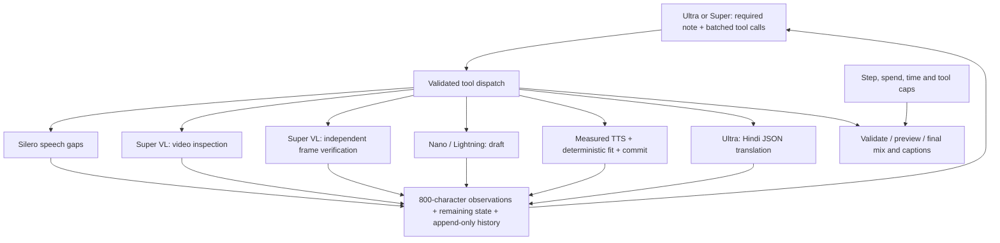

# Narrate

Audio description for blind and low-vision viewers: upload a short video through the CLI and receive English and Hindi narration, WebVTT captions, transcripts, and narrated MP4s with original sound ducked during descriptions. This core pipeline supports the accessibility goal of WCAG 1.2.5 (prerecorded audio description); it is not a compliance certification. No web UI is included.

Built during the submission period for the Nebius x NVIDIA Global AI Hackathon, Best Apps & Agents track, 27 October 2026. Copyright 2026 Nandigam Hari Krishna. Apache-2.0.

## 30-second quickstart

Requires Python 3.13, ffmpeg/ffprobe and espeak-ng with `en` and `hi` voices. Python dependencies install from pip; everything after installation runs offline in mock mode.

```bash
python3 -m venv .venv
.venv/bin/pip install -r requirements.txt
.venv/bin/pip install silero-vad --no-deps
.venv/bin/python -m narrate run samples/sample_kitchen.mp4 --out runs/demo --mock
.venv/bin/python -m pytest -q
```

Open `runs/demo/narrated_en.mp4` or `narrated_hi.mp4`. The same directory contains `ad_en.vtt`, `ad_hi.vtt`, `transcript_en.txt`, `transcript_hi.txt`, and `report.json`. Checked-in mock artifacts are in `samples/outputs_mock/`. Regenerate the synthetic sample using `.venv/bin/python scripts/make_sample.py`.

**Mock means synthetic descriptions, not visual understanding.** Events use the synthetic sample scene sidecar when available, otherwise varied timestamp phrases; Hindi uses natural Devanagari phrases. Usage and would-be Token Factory costs are simulated. A missing selected-provider key selects mock with a warning, unless `--strict` is set. Zero mock cost and latency do not predict real quality, provider cost, or provider latency.

## Real mode (not exercised in this build)

```bash
export NEBIUS_API_KEY='YOUR_RUNTIME_KEY'
.venv/bin/python -m narrate run your_video.mp4 --out runs/real --lang en,hi --budget-usd 0.25
```

Use only a runtime environment variable for the key; no dotenv loading or saved credentials. Response text only is saved under `out/raw/`, truncated to 4,096 characters; headers and requests are never logged. Real mode sends media to Token Factory and incurs charges. No provider calls were made during this implementation; the lead supplied separate NVIDIA development probe results. Token Factory behavior remains **to verify**. Supplied NVIDIA development probe findings are recorded in the Agent section below.

`config.yaml` controls models, prices, budget, silence detection, maximum duration (120 seconds), sample interval, perception strategy, speech rates, voices and ducking. `NARRATE_CONFIG` selects another YAML file. Each model may set `base_url` (for example `https://api.tokenfactory.us-central1.nebius.com/v1/`) and `json_mode: false` if JSON mode is unsupported. To select Lightning, replace `providers.<provider>.models.fit` with the `fit_alt` model ID or mapping. `auto` tries video, then frame grids on API errors or zero valid events; `video_frames` sends at most 16 timestamped separate images; explicit `video` surfaces video errors, and `frames` skips video. Budget errors always stop, without fallback spending.

`tts.backend: auto` selects Piper when both configured ONNX models and companion JSON files exist, otherwise espeak-ng. `silent` is for tests. Install and download:

```bash
.venv/bin/pip install piper-tts
scripts/download_voices.sh
```

Models live in gitignored `voices/`. `en_US-ljspeech-medium` is public domain;
`hi_IN-priyamvada-medium` is CC BY-NC-SA 4.0 and **non-commercial only**.
Piper TTS is GPL-3.0, separately installed and invoked as a CLI subprocess;
no Piper code or models are vendored. The CLI wrapper caps ONNX workers.
Reports identify the backend per cue. Both voices passed local synthesis smoke tests;
Hindi pronunciation still needs native-listener review.

## Pipeline

```text
ffprobe duration check
    -> Super VL: compressed video / timestamped frame contact sheets
    -> ffmpeg silence detection (NumPy energy fallback)
    -> Nano: batched, gap-budgeted English cues, one shorter retry
    -> Ultra: one editorial call + Hindi translation
    -> deterministic validation + espeak/Piper/silent TTS
    -> atempo <=1.35x, trim and flag if still too long
    -> ffmpeg delay + original-audio ducking -> MP4 / VTT / text / report
```

Cue timestamps come exclusively from detected gaps, with 80 ms inset at both ends. Models cannot move cues. Budgets are `max(0, floor(gap_seconds * words_per_second - margin))`. English defaults to 2.3 words/sec, Hindi 2.6. Overlong Nano text gets one shorter-budget retry, then truncation with a report entry. Invalid Ultra cues fall back individually to fitted English; invalid Hindi cues are marked unavailable while valid cues are retained. Continuous sound produces empty cue tracks, not narration over dialogue.

The callable API is `narrate.pipeline.run(path, out_dir, langs, client, budget, progress=callback, config=None, provider=None, strict=False)`. The callback receives `{stage, status}` events. It runs synchronously and can be placed in a UI worker later. Pass a reusable `SpendGuard` as `budget` for a session cap. Provider retries reserve cost separately; failed attempts retain their reservation because billing is uncertain. Reservations estimate text at chars/3, each image at 1,800 tokens, and video at 300 tokens/second; media encoding bytes are excluded. These values and stage output limits (3,000/2,000/4,000) are configurable. Provider billing/tokenization is not locally guaranteed; reported usage above the estimate stops the run. No automatic calls continue after budget exhaustion. `report.json` is saved on failure.

## Nemotron model-by-model

Illustrative token/cost estimates below are planning assumptions, **not measured usage**. Rates are configured USD per million input/output tokens. Batched fitting assigns event indices across gaps and instructs the model to track earlier cues; shorter retries receive previous cues.

| Stage | Model id | Why this model | Calls/video | Illustrative input/output tokens; cost |
|---|---|---|---|---|
| Perceive | `nvidia/Nemotron-3.5-Super-VL` | Visual events and readable text | 1; fallback may add 1 logical call | 8,000/1,000; $0.00330 at 0.30/0.90 |
| Fit | `nvidia/NVIDIA-Nemotron-3-Nano-30B-A3B` | Cheap constrained gap writing | 1 batched; up to 1 shorter retry | 2,000/500; $0.00024 at 0.06/0.24 |
| Alternate fit | `nvidia/Nemotron-3_5-Lightning` | Configurable low-cost alternative | Replaces Nano | 2,000/500; $0.00024 at 0.06/0.24 |
| Edit | `nvidia/Nemotron-3-Ultra-550b-a55b` | Global consistency and bilingual editing | 1 when there are cues | 2,000/1,000; $0.00500 at 1.00/3.00 |

Each logical SDK call permits two transport retries with backoff; Ultra has one logical editorial call. Empty-gap videos skip fit and edit. Reports include configured models, actual/mock call records, token counts, reserved/estimated cost, strategy, fallback, per-stage latency, scheduling coverage, dropped slots and TTS trim flags.

## Where Token Factory helped

The integration is designed around one OpenAI-compatible endpoint for three Nemotron sizes: expensive visual perception and global editing surround cheap Nano fitting. Per-stage model selection allocates cost according to the task; Nano's configured rate also supports future per-gap calls. JSON mode and regional per-model endpoints are configurable. These integration advantages are **to verify** in real mode: video_url acceptance, image-grid interpretation, JSON mode across each model, Hindi quality, regional availability, actual tokenization and pricing. Offline tests verify our request construction paths and deterministic pipeline, not these service claims.

## Providers and smoke diagnostics

| Provider | Runtime key variable | Use |
|---|---|---|
| `nebius` (default) | `NEBIUS_API_KEY` | Final/demo measurements, Token Factory |
| `nvidia-dev` | `NVIDIA_DEV_API_KEY` | Free development only, limited to 40 requests/minute |
| `mock` | None | Offline synthetic descriptions |

**Final/demo numbers must come from provider `nebius`.** NVIDIA development runs carry `"dev_only": true`; `estimated_cost_usd` and `would_be_token_factory_cost_usd` report comparable list-price costs, with `billed_to` identifying the free dev tier. Mock usage is simulated and marked `mock`. Reports record actual used model IDs and endpoint hosts in usage entries.

Use `--provider nebius|nvidia-dev|mock` and `--strict` to prohibit missing-key fallback. `--mock` remains an alias. Configuration has `default_provider`, `providers`, stage-keyed `prices` and `stages`. A provider model value may be an ID string or `{id: ..., base_url: ..., json_mode: false}`. `NARRATE_BASE_URL_NEBIUS` and `NARRATE_BASE_URL_NVIDIA_DEV` override provider URLs; explicit per-model regional URLs take precedence. Per-provider/stage `thinking: false` defaults to `chat_template_kwargs.enable_thinking=false`. The supplied NVIDIA development probes showed that `/no_think` alone does not work. Empty content is retried; reasoning is never treated as the answer. A JSON-mode HTTP 400 retries without response_format and remembers the endpoint/model for that client session.

Run these manually with authorized runtime keys; **they make real requests and Nebius calls incur charges**. They were not run against a provider during this task.

```bash
.venv/bin/python scripts/list_models.py --provider nebius
.venv/bin/python scripts/smoke_video_input.py --provider nvidia-dev
.venv/bin/python scripts/smoke_text.py --provider nebius
.venv/bin/python -m narrate run your_video.mp4 --out runs/real --provider nebius --strict
```

Video smoke compares video data URLs, a contact sheet, and separate frames for a generated four-second RED SQUARE / BLUE CIRCLE clip. Text smoke probes fit, fit_alt and edit for JSON and Devanagari. Both print latency, usage and diagnostic outcomes and save timestamped JSON under `runs/smoke/`. Errors retain only exception class and HTTP status to avoid echoing credentials or media. Rate limiting applies to every inference attempt, including retries.

## Results card — MOCK

Synthetic 30-second kitchen-title clip; espeak English and Hindi; no real visual analysis or human accessibility evaluation.

| Metric | MOCK result |
|---|---|
| Scheduled gap coverage | 91.77% English / 91.77% Hindi |
| Overlaps with dialogue | 0 detected-gap boundary violations (not a speech-recognition assessment) |
| Cues dropped | 1 gap too short after inset/budget |
| TTS cues trimmed | 0 |
| Cost/minute | $0.00, offline mock |
| Pipeline latency | Approximately 3 seconds on this shared CPU host; see cached report |

For a real results card replace these fields with measured values, model/region, clip cohort, accessibility review findings, and date. Gap coverage measures allocated cue windows divided by detected silent seconds, not useful information coverage or audible narration occupancy.

## Limitations & published failure cases

- Fast cuts and sparse frame sampling miss actions; timestamp mock events do not detect visual scenes.
- Sub-second gaps may be skipped; aggressive word truncation and speech trimming can hurt comprehension.
- Continuous speech can leave no safe gaps: extended AD with paused video is needed and not implemented.
- The baseline energy/silence detector is not speech recognition. The agent uses Silero VAD, which can still miss robotic or quiet speech. Quiet speech can be mistaken for silence; music can hide safe speech-free intervals. Zero scheduled violations cannot establish zero real dialogue overlap.
- On-screen Hindi text and translations need native-reader review. Ultra failure leaves Hindi descriptions unavailable.
- espeak voices sound robotic; Piper voice quality still needs listener review.
- VL hallucinations and stale event selection are possible. Human review is required before relying on descriptions.
- The synthetic sample uses captions and shapes, not a filmed kitchen. Mock-mode numbers are not quality numbers.
- Video_url schema, model JSON support, regional routing and cost estimates are not yet verified against Token Factory.

See [issues-found](issues-found/README.md) for evidence, causes and status. Tests run entirely offline, including full-pipeline tests marked `slow` but included by default. Output video streams are copied; input formats/codecs must be compatible with MP4. This prototype does not run OCR, diarization or safety-critical scene interpretation.


## Agent vs fixed pipeline

```bash
python -m narrate agent samples/sample_kitchen.mp4 --out runs/agent_mock --provider mock
python -m narrate pipeline samples/sample_kitchen.mp4 --out runs/baseline --provider mock
# run remains an alias for pipeline
python scripts/make_sample.py --kind lecture
python -m narrate agent samples/failure_continuous_speech.mp4 --out runs/agent_failure --provider mock
python scripts/eval_against_subs.py dialogue.srt runs/agent_mock/report.json --offset 0
```

The baseline runs a fixed perceive → fit → edit sequence. The agent gives Ultra
OpenAI function schemas and lets it choose tools, inspect observations, revise
failed descriptions and finalize. Every tool schema requires a string `note` (at most 25 words),
not chain-of-thought. Mock uses a deterministic script and sidecar facts;
its corrections demonstrate control flow, not reasoning quality.



| Tool | Behavior |
|---|---|
| detect_speech_gaps | Silero ONNX; 300 ms smoothing, minimum gap 1.2 s, language word budgets, speech ratio; reported silence/energy fallback |
| inspect_video_segment | One gap neighbourhood `[max(0,start-6),end]`; >=70% overlap returns cached events and reminder; default 12 inspections |
| verify_claim | Independent sampled frames; supported/contradicted/uncertain with evidence; default 8 calls |
| draft_description | One budgeted line or a batch via optional `gap_ids` |
| measure_tts_duration | Cached configured-backend synthesis |
| check_fit | Words, measured duration, <=1.25x speed, no speech overlap, banned phrases |
| propose_cue / commit_cue / drop_gap | Only fit English can commit; explicit reasons for dropped gaps |
| translate_hindi | Ultra translation; measured duration is primary, one internal retry with max_words/max_seconds, per-cue status |
| render_preview | Narration-mixed MP4 excerpt |
| finalize | Validate, report uncovered important events, reject at most twice; then output safe tracks with warnings |

| Role | Nebius model | NVIDIA development model |
|---|---|---|
| Orchestrate | nvidia/Nemotron-3-Ultra-550b-a55b | nvidia/nemotron-3-ultra-550b-a55b |
| Inspect / verify | nvidia/Nemotron-3.5-Super-VL | nvidia/nemotron-3.5-super-vl-120b-a12b |
| Draft | nvidia/NVIDIA-Nemotron-3-Nano-30B-A3B | nvidia/nemotron-3.5-lightning-30b-a3b |
| Translate | nvidia/Nemotron-3-Ultra-550b-a55b | nvidia/nemotron-3-ultra-550b-a55b |

Nebius orchestrator alternative: `nvidia/nemotron-3-super-120b-a12b`.
Provider/stage model mappings support regional base URLs. Token Factory has
not been live-tested. Supplied NVIDIA probes establish Ultra tool calling,
VL video/images and the thinking control; see [findings](issues-found/agent-probes.md).

Defaults: 30 orchestrator turns, $0.50 reserved spend cap including submodels/retries,
600-second wall-clock deadline checked between operations, provider rate
limiting, structured observations capped at 800 characters, rounded to two decimals, with state summaries and append-only history.
Budget exhaustion, step exhaustion or a tool-less answer invokes a deterministic
finisher using committed cues only. Rendering can extend beyond the model-loop
deadline. Mock calls cost zero and need no provider SDK connection.

The streaming entry point is
`narrate.agent.run_agent(path, out_dir, provider, langs, max_steps, budget_usd, on_step=callback)`.
The synchronous callback receives each trace step. No UI is built yet.
Outputs include bilingual MP4/VTT/transcripts, `report.json`, `trace.json`,
`trace.md` and a requested preview. Trace metadata includes provider, role
models, endpoint host, development-only status and budgets. Steps include
public notes, tool arguments, compact results, usage/cost/latency and correction
links. Report coverage of important events is a **temporal association proxy**,
not semantic validation. Caption coverage measures actual scheduled narration
duration. Missing Hindi is explicitly reported, never silently fabricated in
real mode.

### Trace excerpt — MOCK

From the offline kitchen run (scripted, not model reasoning):

```text
8  ✓ draft_description: deliberately over-budget mock draft
10 ✗ check_fit: Word budget exceeded
13 ↪ draft_description: shorter scene-grounded text (corrects 10)
16 ✗ verify_claim: contradicted — no blue dot or fading text in sidecar
18 ↪ check_fit: corrected title text fits (corrects 16)
20 ✓ commit_cue
53 ✓ translate_hindi
55 ✓ render_preview
57 ✓ finalize
```

The espeak mock run committed 4 cues, recorded 2 corrections and 1 contradicted
verification, and reported 0 overlaps with **detected** speech. English/Hindi
narration occupies about 43.8%/62.6% of available gap time; local latency was
about 4.1 seconds. These are synthetic control-flow measurements, not quality
claims or provider benchmarks. Regenerate to obtain current timings.

### Speech detection and published failure case

Install `silero-vad --no-deps` alongside `onnxruntime`; Narrate loads the MIT
ONNX model directly without torch. Attribution and license are in
[narrate/assets](narrate/assets/README.md). If unavailable, the report names
the fallback detector. Silero can miss robotic speech, as the supplied film
probe did: zero detected overlap does not prove zero dialogue overlap.
Use `scripts/eval_against_subs.py VIDEO.srt REPORT_OR_VTT [--offset S]` for
subtitle-ground-truth overlap seconds and dialogue-free narration coverage.
For VTT, supply `--duration` to include trailing free time; otherwise the
last cue/subtitle end is explicitly reported as the estimated duration.
Offsets shift subtitles (use a negative offset for an excerpt).

The published `failure_continuous_speech.mp4` is a 30-second synthetic lecture.
The offline run finds zero usable gaps, writes empty AD tracks and reports
that narration requires extended AD (pause-the-video), which is not implemented.
Sample provenance and the film soundtrack licensing caveat are recorded in
[samples/SOURCES.md](samples/SOURCES.md). Media names are never hard-coded in
the agent; optional `.scenes.json` sidecars only inform mock descriptions.


## First real run and cost fixes

**First real run, nvidia-dev, would-be Token Factory list price** (BLOG_NOTES,
27 October 2026, 23:30; HEAD bf693ad): the 30-second synthetic kitchen clip took
3 min 44 s, 101 trace steps and 40 orchestrator turns, then fallback finalization.
Total cost was about **$0.144**, including **$0.130 (90%) orchestration**.
Ultra orchestration used 121,496 input / 2,452 output tokens over 128 s;
14 VL calls used 34,593 / 3,480 tokens over 78 s. Five Lightning calls took
2.6 s and the Ultra Hindi pass took 7 s. Four corrections were recorded.
English/Hindi gap coverage was 91%/11%, with only one of four Hindi cues surviving.

| Same sample | Fixed pipeline | First real agent | Revised agent (offline target) |
|---|---|---|---|
| Would-be cost | ~$0.003 | ~$0.144 (~50x) | Not measured against a provider |
| Wall time | 12.6 s | 224 s | Offline timing is not a provider benchmark |
| Control | Fixed perceive/fit/edit | 40 turns, 13 inspections | <=20 scripted mock turns; default cap 30 |
| Review | Editorial pass | Four corrections, independent frame checks | Verify uncertain claims; cache repeated inspections |
| Hindi | Editorial translation | 1/4 cues survived | Duration-first fit; one shorter retry |

The efficient plan is gaps → parallel gap-neighbourhood inspections → batched
drafts → propose_cue → verify uncertain claims → translate once → finalize.
Tool calls in a turn execute in order, without extra worker threads. Each result
includes committed cue IDs, remaining gap IDs and remaining turn/inspection/
verification budgets; repeated gap detection does not repeat the gap list.
History stays append-only to preserve provider prompt-cache prefixes.
Three turns before exhaustion, the loop nudges commit/translate/finalize.
The fallback attempts missing translation subject to remaining spend/time limits.
Missing Hindi after a retry produces warnings and coverage, rather than blocking output.

Use `--orchestrator ultra|super`; Super selects
`nvidia/nemotron-3-super-120b-a12b` on Nebius. Super is not available through
this configuration's nvidia-dev endpoint. `parallel_tool_calls` defaults on;
set it false on the model mapping for an endpoint that does not support it.
Cached input rates per million tokens: Ultra $0.12, Super $0.06, Super VL $0.06,
Nano $0.012, Lightning $0.03. Returned cached tokens are recorded and discounted.
`estimated_cost_usd` sums actual per-call list-price estimates, including dev runs;
reservations stay separate. `cost_per_minute_usd`, `cost_by_role` and `billed_to`
make comparisons explicit. Failed transport calls without usage retain budget
reservations but cannot provide measured list-price costs.

`high_importance_covered_percent` considers only events overlapping a gap or
ending within six seconds before one. Coverage remains a temporal proxy.
Static-text motion hallucinations remain open: neither caching nor frame checks
guarantee perceptual correctness. No real provider calls were made for these fixes.
